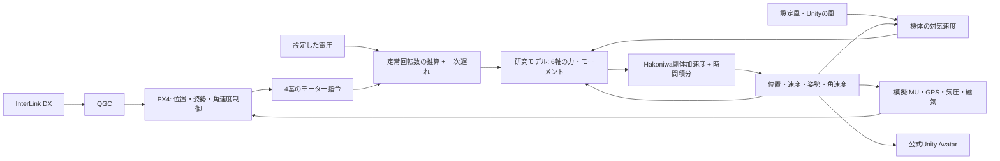

# 研究モデルを使う操縦シミュレータ

## 計算の流れ



実機ログや実測RPMは再生していない。プロポ操作に応じたPX4の指令から回転数を生成し、
その時点の速度・姿勢・角速度で6軸荷重を計算する。Unityは機体の表示と箱庭の操作を担当する。

## 取り込んだ研究内容

- 保存版 `retest-motor-20261111` の全6軸荷重。風速別のモデル切り替えや、実測初期荷重の足し込みはしない。
- 指令・電圧から4基それぞれの回転数を求めるKaufmann形式の定常モデルと一次遅れ。
  保存値の時定数は約55.6 ms。二重に別の50 ms遅延を足さない。
- 流入方向、回転運動、回転数と差動量、誘導流を含む保存済みの候補項・係数。
- 回転数二乗の推進、重心へのモーメント換算、ローター加減速の反作用とジャイロ効果。
- 保存モデルの質量1.52215 kg、慣性 [0.0169, 0.0165451, 0.0275784] kg m²。
- 空気密度による空力荷重の倍率。ローターの角運動量には密度倍率を掛けない。

元データの処理に使ったセンサ自己荷重・零点補正などは、保存係数を作る過程で使われている。
センサや試験台を飛行機体に追加することはしない。

`research_model/` は研究用の公開準備フォルダにある `model.json`、`simulate.py`、
`aerodynamics.py` のスナップショット。付属の簡易制御器は使わず、実際のPX4 SITLを使う。
同定係数を変えた場合は、このコピーを明示的に更新して検査する。

## 比較と設定

| 選択 | 荷重 | 質量・慣性・モーター・PX4 |
|---|---|---|
| 研究モデル | 保存済みgray-box、全6軸 | 研究設定 |
| 回転数二乗モデル | RPM²＋重心換算＋ローター反作用 | 研究モデルと共通 |
| 公式X500 | 公式のネイティブ力学サービス | 公式設定 |

既定は `command_route` の荷重係数を使う。`--route measured` は実測RPMで同定した係数を選ぶ。
どちらも操縦中のRPMはシミュレーションで生成した値であり、「実測RPMを入力する比較」ではない。
研究用のPX4設定は `research-parameters.json`。公式X500は研究モデルの精度比較用の対照とは区別する。

```bash
# 研究モデル、16 V、密度1.225 kg/m³、北向き2 m/sの一定風
python3 desktop.py launch hakoniwa --wind-ned 2 0 0

# 同じ条件の回転数二乗モデル
python3 desktop.py launch hakoniwa --model existing --wind-ned 2 0 0

# 実測RPM用の荷重係数と、Rollを直接同定した式を使う場合
python3 desktop.py launch hakoniwa --route measured --direct-roll
```

風はNED座標で「空気が進む向き」を指定する。Unityの風領域による値を加算し、時定数2 sで変化させる。
密度は `--density`、電圧は `--voltage` で指定する。電池消費による電圧低下はまだ計算しない。
アプリ一覧の各モデルを選ぶと16 V・無風などの既定値に戻る。「箱庭を再起動」は指定値を保持する。

## 適用範囲と仮定

- モーター校正範囲は指令0.30〜0.70、電圧約14.07〜16.36 V。指令の範囲外はログに記録する。
- 起動・停止を扱うため、4基の最小回転数が3000 rpm以下では追加荷重を使わず、3000〜3500 rpmで滑らかに立ち上げる。
  1基だけ停止する場合にも流入比が発散しないよう、平均回転数では判定しない。
  この範囲は起動用の延長であり、実験で検証済みの予測とは扱わない。RPM自体を下限値に置き換える処理ではない。
- 既定のRollは保存モデルに従い、Pitchの特性を±90°回転して利用する。対称性の仮定を含む。
- 対気速度11.5 m/s超、誘導流の解を一意に決められない状態などでは停止して理由を保存する。
- 地面は平面の支持だけを計算する。地面効果・障害物への接触・プロペラ破損は含まない。
- HILは250 Hz、描画用PDU・CSVは50 Hz。模擬GPSと模擬IMUでPX4が自己状態を推定する。
  実機と同程度のセンサ誤差・通信断を再現した試験ではない。
- 研究版は公式Hakoniwaの加速度計算に専用の中点法を組み合わせている。
  公式X500のMuJoCoサービスそのものに係数を差し込んだ構成ではない。

これで研究モデルを操縦して調べられる。操縦できたこと自体を、自由飛行に対する精度の証明とはしない。

## 記録と検査

Python環境は研究室PCの既存 `.venv-analysis` を使用する。新しいPCでは
`requirements-research.txt` を導入した環境のPythonを `HAKO_PYTHON` で指定する。
研究データのファイルへのアクセスは不要。

各セッションの `research-manifest.json` にモデルのSHA256、全係数、諸元、仮定を保存する。
`research-flight.csv` には状態・4基の生成RPMと指令・6軸荷重・風・範囲外フラグを保存する。
状態はNED/FRD、姿勢は機体→世界の四元数 [w,x,y,z]。CSVのx0〜x12は順に位置3、速度3、四元数4、角速度3。
`research-status.json` は最新状態、失敗時は `research-error.txt`、PX4ログは `px4.log` に残る。

`verify_research.py` は保存モデルとの加速度・荷重の照合、座標変換、密度補正を検査する。
`--flight` は隔離したローカルSITL instance 10 / system 11だけをPositionモードで操縦し、離陸・前後入力・着陸を確認する。
`--multi-axis` では左右とYawの入力も加える。全飛行モード・全風速の動作を保証する検査ではない。
通常起動のinstance 8に自動操縦指令を送らない。検査結果は `research-verification/` に保存する。

`python3 launcher/verify_avatar.py --session sessions/対象セッション` は操縦せずに、箱庭の共通時計が進み、
Unityが書き戻すLiDAR位置が機体位置を追っているかを検査する。結果はセッションの
`avatar-verification.json`。PX4の飛行検査とは別に、この表示経路の検査を行う。
2026-11-12に、研究側のPDU書き込み完了通知が欠けて共通時計が0秒で止まる不具合を修正した。

## 変更対象

この追加は箱庭用フォルダ内に限定した。論文・承認済み第6章・元の解析係数・実験の生データは変更しない。
